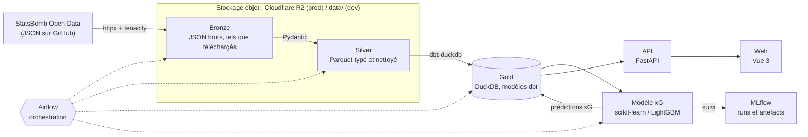
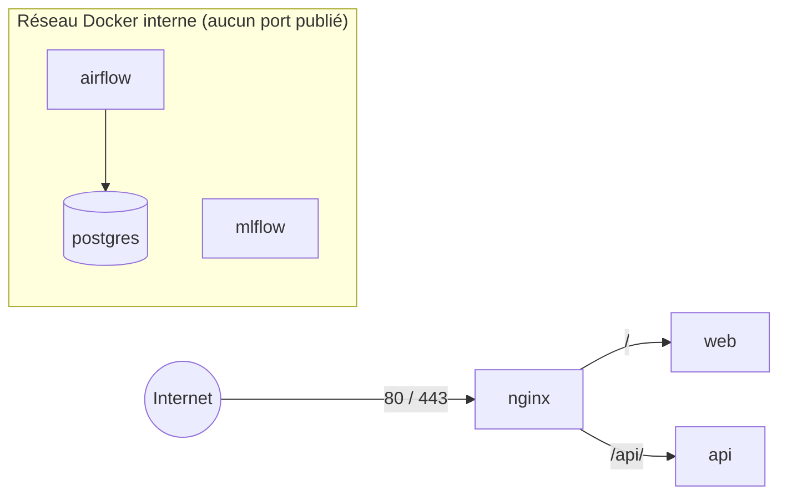

# Architecture

D-Foot suit une architecture en médaillon : chaque couche est dérivée de la précédente et peut être reconstruite à partir d'elle.

## Couches

| Couche | Format | Emplacement | Contenu |
|---|---|---|---|
| Bronze | JSON | R2 / `data/bronze/` | Fichiers StatsBomb bruts, non modifiés : la source de vérité locale. |
| Silver | Parquet | R2 / `data/silver/` | Données typées et validées, une table par entité (matchs, événements...). |
| Gold | DuckDB | volume `gold-data` / `data/gold/` | Modèles dbt prêts à servir : staging → intermediate → marts. |

## Composants

- **`dfoot-core`** : configuration (`settings.py`) et abstraction de stockage (`storage.py`). Le reste du code n'accède au stockage que par cette interface, ce qui permet de passer de `local` à `r2` sans rien changer d'autre (voir [ADR 001](decisions.md)).
- **`dfoot-ingestion`** : téléchargement StatsBomb → bronze, puis bronze → silver.
- **`transform/`** : projet dbt qui lit le silver (Parquet) et construit le gold dans DuckDB.
- **`dfoot-ml`** : entraînement et évaluation du modèle xG, suivi dans MLflow.
- **`dfoot-api`** : API HTTP en lecture sur le gold.
- **`web/`** : application Vue qui consomme l'API.
- **`dags/`** : DAG Airflow qui enchaîne ces étapes.

## Réseau en production

Seul nginx est exposé publiquement. `api` et `web` ne sont publiés que sur `127.0.0.1`. Les consoles Airflow et MLflow ne sont accessibles que par tunnel SSH (voir [deploiement.md](deploiement.md)).
